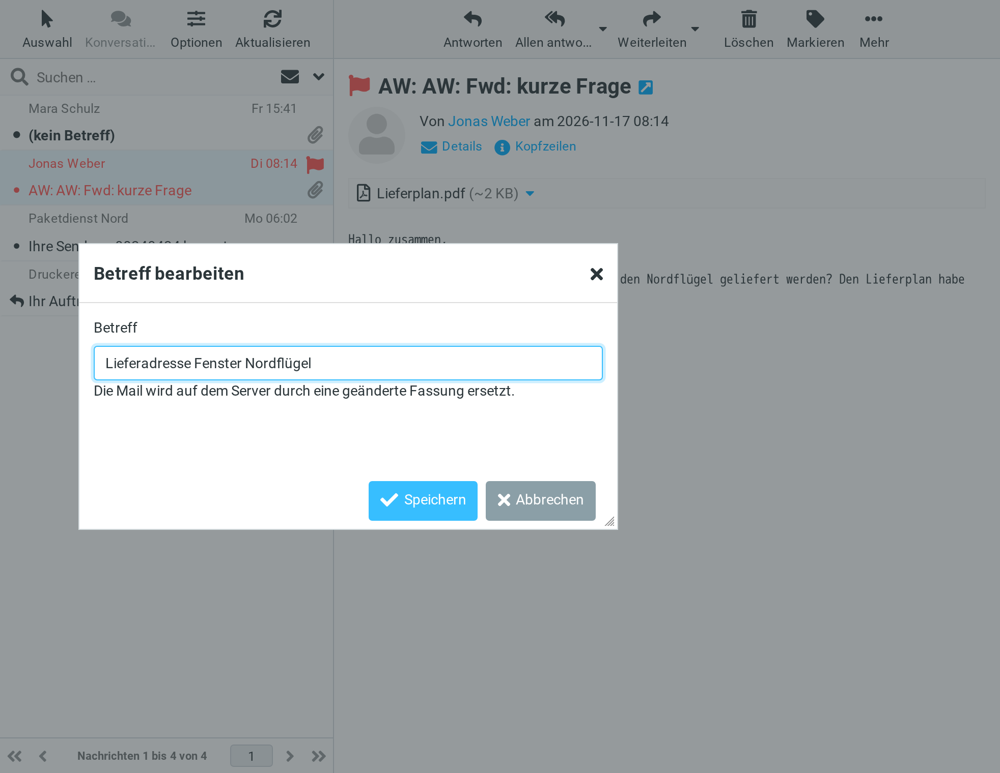
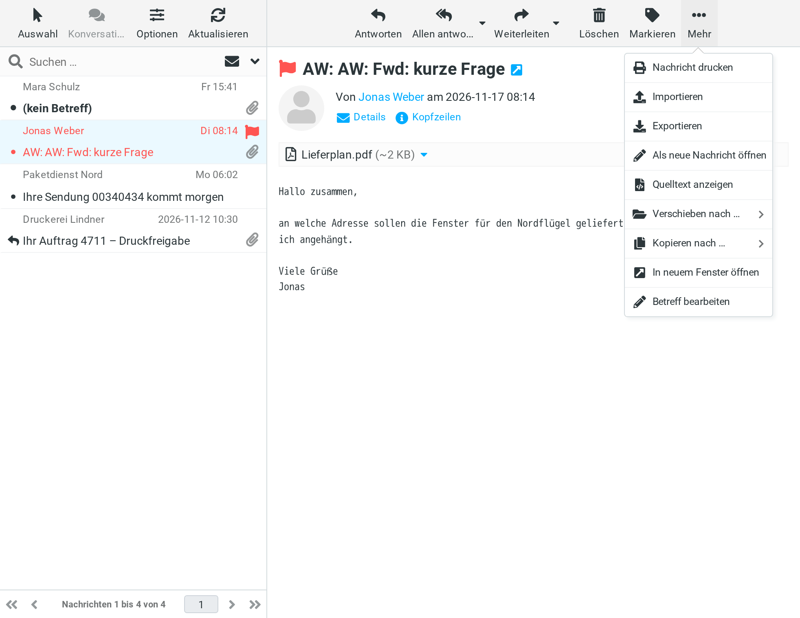
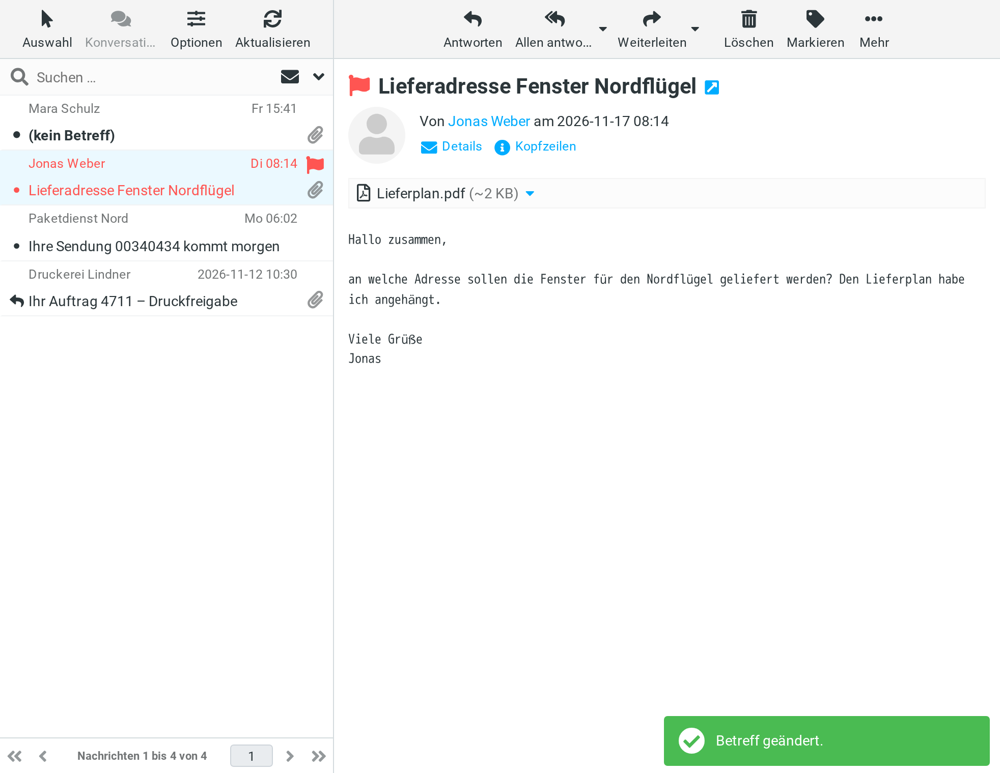

# edit_subject – Betreff bearbeiten für Roundcube

[](https://github.com/Kaleidostar/roundcube-edit-subject/actions/workflows/tests.yml)
[](https://github.com/Kaleidostar/roundcube-edit-subject/releases)
[](LICENSE)
[](https://roundcube.net/)
[](https://www.php.net/)

Mit diesem Plugin lässt sich der Betreff einer vorhandenen Mail ändern. Die
Änderung steht in der Mail selbst und ist deshalb in jedem Mailprogramm
sichtbar, nicht nur in Roundcube.



IMAP-Nachrichten sind unveränderlich. „Bearbeiten“ heißt deshalb: Das Plugin
legt eine geänderte Fassung im selben Ordner ab, prüft sie und entfernt erst
danach das Original. Für den Nutzer sieht es aus wie Bearbeiten: Die Mail
steht an derselben Stelle der Liste, mit denselben Markierungen und demselben
Datum, ohne Duplikat.

## Funktionen

- Eintrag „Betreff bearbeiten“ im Mehr-Menü der Mailliste, der geöffneten Mail
  und einer Mail im eigenen Fenster
- Nur das Feld `Subject` ändert sich. Alle anderen Kopfzeilen und der Körper
  bleiben bytegenau, Flags, Schlüsselwörter und Eingangsdatum bleiben erhalten.
- Die neue Fassung wird geprüft, bevor das Original gelöscht wird. Scheitert
  das Löschen, wird die Änderung zurückgenommen.
- Fehlen UIDPLUS oder die nötigen Rechte, bricht das Plugin ab, bevor es etwas
  schreibt.
- Geändert wird nur die Mail, deren Betreff im Dialog stand. Wurde sie
  inzwischen geändert, verschoben oder gelöscht, passiert nichts.
- Liste, Suche, ordnerübergreifende Suche, Thread-Ansicht und offene Fenster
  werden nachgeführt.
- Auf Wunsch bleibt der ursprüngliche Betreff als `X-Original-Subject` erhalten.
- Oberfläche auf Deutsch und Englisch

## Voraussetzungen

- Roundcube 1.7 (getestet mit 1.7.6) oder 1.6 (getestet mit 1.6.21), Skin Elastic
- PHP ab 8.1; keine zusätzlichen PHP-Abhängigkeiten
- IMAP-Server mit der Erweiterung **UIDPLUS** (RFC 4315), zum Beispiel Dovecot.
  Ohne UIDPLUS verweigert das Plugin die Arbeit. Roundcube würde zum Löschen
  sonst `CLOSE` oder ein einfaches `EXPUNGE` verwenden, und beides entfernt
  alle als gelöscht markierten Mails des Ordners, nicht nur das Original.
  Gefragt wird die Verbindung der laufenden Anfrage, nicht nur Roundcubes
  Sitzungspuffer; das gilt auch mit der Option `imap_force_caps`.
- Meldet der Server Zugriffsrechte (ACL, RFC 4314), prüft das Plugin sie vorher.
  Gebraucht werden `i`, `t` und `e`, dazu `s` und `w`, wenn die Mail Markierungen
  trägt.
- Roundcubes Temp-Verzeichnis (`temp_dir`) gehört dem Webserver allein, wie es
  Roundcube selbst voraussetzt. Dort liegen während einer Bearbeitung die Mail
  und eine Sperrdatei mit vorhersagbarem Namen. Liegt an diesem Namen etwas
  anderes als eine gewöhnliche Datei, etwa ein symbolischer Link, benutzt das
  Plugin es nicht und bearbeitet die Mail nicht; geschrieben wird nur in
  Dateien, die es selbst angelegt hat. Wer in dem Verzeichnis schreiben darf,
  kann Bearbeitungen also blockieren, und weil die Sperre je Konto gilt, alle
  Bearbeitungen dieses Kontos. Kann das Dateisystem gar nicht sperren
  (`flock`), bearbeitet das Plugin nichts, meldet ein Problem mit einer
  temporären Datei und nennt den Grund im Fehlerlog.

## Installation

Ein Datenbankschema ist nicht nötig. Nach der Installation die Seite in
Roundcube neu laden.

### Release-ZIP

1. `edit_subject-<version>.zip` von der
   [Release-Seite](https://github.com/Kaleidostar/roundcube-edit-subject/releases)
   laden und so nach `plugins/` der Roundcube-Installation entpacken, dass
   `plugins/edit_subject/` entsteht. Die Prüfsumme steht in der
   `.sha256`-Datei daneben.

   ```bash
   sha256sum -c edit_subject-1.0.3.zip.sha256
   cd /pfad/zu/roundcube/plugins
   unzip /pfad/zu/edit_subject-1.0.3.zip
   ```

   Die Prüfsumme deckt Übertragungsfehler auf. Sie liegt im selben Release
   wie das ZIP und belegt allein deshalb nicht, woher es stammt. Releases,
   die mit dem aktuellen Workflow erzeugt wurden, besitzen zusätzlich eine
   SLSA-Build-Provenance. Sie lässt sich mit der GitHub CLI prüfen:

   ```bash
   gh attestation verify edit_subject-X.Y.Z.zip \
     --repo Kaleidostar/roundcube-edit-subject \
     --signer-workflow Kaleidostar/roundcube-edit-subject/.github/workflows/release.yml \
     --source-ref refs/tags/X.Y.Z
   ```

   Die beiden letzten Angaben binden die Prüfung an den Workflow `Release`
   und an genau diesen Tag. Mit `--repo` allein gilt jede Attestierung aus
   irgendeinem Workflow des Repos, von jedem Zweig.

   Wer den Inhalt zusätzlich selbst nachbauen will, verwendet
   `./release.sh <version>` am getaggten Commit: Das ZIP hängt nur vom Commit
   ab und muss dieselbe Prüfsumme tragen.

2. Das Plugin in `config/config.inc.php` aktivieren:

   ```php
   $config['plugins'] = ['edit_subject' /* , weitere Plugins */];
   ```

### Composer

Im Verzeichnis der Roundcube-Installation:

```bash
composer config repositories.edit_subject vcs https://github.com/Kaleidostar/roundcube-edit-subject
composer require kaleidostar/edit_subject:^1.0
```

Der Roundcube-Plugin-Installer legt das Plugin unter `plugins/edit_subject/`
ab, prüft die Roundcube-Version und fragt, ob er es aktivieren soll. Beide
Befehle gehören zusammen: Das Paket liegt nicht auf Packagist, ohne den
ersten sucht Composer den Namen dort.

### Git (nur zum Entwickeln)

```bash
git clone https://github.com/Kaleidostar/roundcube-edit-subject.git /pfad/zu/roundcube/plugins/edit_subject
```

Danach wie beim Release-ZIP in `config/config.inc.php` aktivieren.

Nicht für Server: Ein Klon legt außer dem Plugin auch Tests, Skripte und das
Verzeichnis `.git` ins Plugin-Verzeichnis. Roundcube 1.6 liefert solche
Dateien ohne Anmeldung aus (gemessen mit 1.6.21, darunter `.git/config` und
`tests/`), Roundcube 1.7 einen Teil davon (gemessen mit 1.7.6:
`docs/showcase.html`). Das Release-ZIP enthält nur das Plugin, ebenso eine
Composer-Installation aus dem Archiv einer Version, wie sie der Befehl oben
ergibt. Mit `--prefer-source` oder einer Entwicklungsfassung (`dev-main`) legt
auch Composer einen Klon ab.

### Docker-Image `roundcube/roundcubemail`

Das entpackte Release-ZIP (nicht einen Klon, siehe oben) nach
`/var/www/html/plugins/edit_subject` einhängen und `edit_subject` in
`ROUNDCUBEMAIL_PLUGINS` aufnehmen.

## Konfiguration

`config.inc.php.dist` nach `config.inc.php` im Plugin-Verzeichnis kopieren und
anpassen. Die Option kann auch in der Hauptkonfiguration stehen.

| Option | Standard | Bedeutung |
|---|---|---|
| `edit_subject_keep_original` | `false` | Schreibt den ursprünglichen Betreff unverändert als `X-Original-Subject` in die Mail. Existiert das Feld schon, bleibt es stehen. Nach mehreren Bearbeitungen enthält es also den allerersten Betreff. |
| `edit_subject_max_message_size` | `67108864` | Maximale Gesamtgröße der Mail, Kopf und Körper zusammen: Byte als Zahl oder mit Einheit K, M oder G wie bei Roundcubes eigenen Größenangaben (`'64M'`). Größere Mails werden vor dem Abruf von Kopf oder Körper abgelehnt. Alles andere (0, negative Zahlen, Brüche wie `'1.5M'`, `true`) ist keine Größe: Es gilt der Standard von 64 MiB, und das Fehlerlog sagt das. |

`X-Original-Subject` ist eine Gedächtnisstütze, kein Nachweis: Bringt eine
Mail das Feld schon mit, etwa weil der Absender es gesetzt hat, bleibt auch
dieses stehen, und der tatsächliche erste Betreff wird nicht aufgezeichnet.

## Bedienung

Im Mehr-Menü der Mailliste, der geöffneten Mail und einer Mail im eigenen
Fenster steht „Betreff bearbeiten“. Der Eintrag ist nur aktiv, wenn genau eine
Mail ausgewählt oder geöffnet ist. Der Dialog ist mit dem aktuellen Betreff
vorbelegt. Enter speichert, Esc bricht ab. Ein unveränderter Betreff löst keine
Aktion auf dem Server aus. Ein leerer Betreff ist erlaubt, höchstens 500 Zeichen
sind möglich.

<p>
  
  
</p>

Eine interaktive Demo des Ablaufs liegt in [`docs/showcase.html`](docs/showcase.html):
eine einzelne HTML-Datei ohne externe Abhängigkeiten, zum Herunterladen und
Öffnen im Browser.

## Ablauf und Datensicherheit

Grundregel: lieber abbrechen oder ein Duplikat hinterlassen, als eine Mail zu
verlieren oder zu verändern, die nicht bearbeitet werden sollte. Was ein
anderes Programm während der Bearbeitung mit der Mail tut, Löschen und
Verschieben eingeschlossen, macht das Plugin nicht rückgängig.

1. Angenommen werden nur POST-Anfragen des eigenen Client-Codes mit gültigem
   Request-Token; UID und Ordner werden geprüft. Roundcubes eigene Prüfung
   ließe GET-Anfragen durch und liest die UID auch aus einem Cookie; eine
   Anfrage mit einem Cookie `_uid` wird deshalb abgelehnt. Je Konto und Host
   läuft nur eine Bearbeitung gleichzeitig. Das begrenzt zugleich den
   Temp-Verbrauch auf eine Mail pro Konto; ein Fehler beim Setzen der Sperre
   bricht ab, statt ungeschützt weiterzuarbeiten.
2. Ohne UIDPLUS auf der Verbindung dieser Anfrage: Abbruch.
3. Wo der Server ACL meldet: Abbruch, wenn Rechte fehlen. Ebenso bei einem
   nur zum Lesen geöffneten Ordner.
4. Die konfigurierte Gesamtgrößengrenze (standardmäßig 64 MiB) wird vor dem
   Abruf geprüft. Flags, Schlüsselwörter (ohne `\Recent`), INTERNALDATE, Größe
   und Kopf des Originals lesen. Der Kopf darf höchstens 4 MiB groß sein und
   20 000 Zeilen
   haben. Steht dort nicht mehr der Betreff, mit dem der Dialog geöffnet
   wurde: Abbruch. So trifft die Änderung keine andere Mail mit derselben UID
   und keine, die inzwischen ersetzt wurde. Der alte Betreff wird gelesen, wie
   Roundcube ihn anzeigt: das letzte `Subject`-Feld, roher 8-Bit-Text mit dem
   Zeichensatz der Mail. Dekodiert werden höchstens die ersten 8192 Byte.
5. Header-Block und Mailkörper gestreamt in eine Datei mit Rechten 0600 im
   Roundcube-Temp-Verzeichnis schreiben. Die Datei wird nach jedem Ausgang
   wieder gelöscht, auch nach Fehlern und Abbrüchen von PHP; die Reste eines
   hart beendeten Prozesses räumt Roundcube mit seinen übrigen Temp-Dateien
   ab. Die Mail liegt dabei nie vollständig im Arbeitsspeicher; bei 25 MB
   lag die Spitze in den Tests bei 6 MiB. In die Datei gelangt höchstens ein
   Byte mehr, als der Server mit RFC822.SIZE angekündigt hat, auch wenn er
   mehr sendet; ein solcher Körper führt zum Abbruch.
6. Nur das Feld `Subject` wird ersetzt, alle anderen Kopfzeilen und der Körper
   bleiben bytegenau. Reines ASCII steht unkodiert im Feld, alles andere als
   UTF-8-Encoded-Words; ASCII ebenfalls, wenn die Mail einen Zeichensatz
   nennt, mit dem Roundcube rohen Text anders läse (UTF-16, UTF-7).
7. Die Kopie mit denselben Flags und demselben INTERNALDATE ablegen (APPEND).
   Bleibt die Antwort des Servers aus, wird nichts gelöscht; das Plugin
   meldet, dass die Kopie möglicherweise angelegt wurde.
8. Die Kopie prüfen: Größe, Header-Block, dekodierter Betreff, vollständige
   Flag-Menge und INTERNALDATE. Der Körper wird mit SHA-256 bytegenau mit dem
   zuvor gesendeten Körper verglichen. Ist etwas falsch, wird die Kopie
   entfernt. Hat ein anderes Programm das Original inzwischen geändert oder
   entfernt, sagt die Meldung das, statt es „unverändert“ zu nennen.
9. Das Original noch einmal lesen. Hat ein anderes Programm es inzwischen
   geändert, verschoben oder gelöscht, gilt dessen Änderung: Die Kopie wird
   zurückgenommen, auch wenn sie danach die einzige Fassung wäre, und das
   Plugin meldet, dass die Mail nicht mehr die aus dem Dialog ist. Sonst
   Vorhandensein und Flags der Kopie erneut prüfen: Hat sie inzwischen jemand
   entfernt, verschoben oder mit anderen Flags versehen, bleibt das Original
   stehen, und eine noch vorhandene Kopie wird zurückgenommen. Sonst wird das
   Original gelöscht, genau diese eine UID, und nachgeprüft, dass es wirklich
   weg und die Kopie noch da ist.
10. Ist das Original noch da, nimmt das Plugin zuerst seine Löschmarkierung
    zurück und liest das Original danach erneut. Die Kopie wird erst entfernt,
    wenn es unverändert und ohne Löschmarkierung wiedergefunden ist. Hat ein
    anderes Programm das markierte Original in der Zwischenzeit aus dem Ordner
    geräumt, bleibt die Kopie als einzige Fassung, und die Bearbeitung gilt
    als gelungen. Gelingt der Rückbau nicht, bleiben beide Fassungen, und das
    Plugin meldet das.
11. Zurückgenommen wird nur, was als die eigene Kopie erkannt ist: Der Server
    hat ihre UID für genau diesen Ordner genannt, oder sie trägt den Kopf, der
    geschrieben wurde. Eine UID allein genügt nicht.

Fehler auf dem Server stehen im Roundcube-Fehlerlog: fehlendes UIDPLUS,
fehlende Rechte, gescheitertes Ablegen, fehlgeschlagene Prüfung,
gescheitertes Löschen. Ein erfolgreicher Lauf schreibt dort nichts, außer er
ist erst im Rückbau gelungen (Schritt 10). Jeder Fehler erscheint als Meldung
in der Sprache des Nutzers (Deutsch und Englisch).

## Nebenwirkungen

- **Neue UID.** Die Mail ist für den Server eine neue Nachricht. Andere
  IMAP-Programme sehen beim nächsten Abgleich, dass die alte Nachricht
  entfernt wurde und eine neue hinzugekommen ist. POP3-Abrufe, die Mails auf
  dem Server lassen, laden sie unter Umständen erneut herunter. Verweise auf
  die alte UID werden ungültig.
- **DKIM-Signaturen** über das Feld `Subject` werden ungültig. Das betrifft
  praktisch jede DKIM-Signatur. Signaturen über den Mailkörper (S/MIME,
  PGP/MIME) bleiben gültig, weil der Körper bytegenau erhalten bleibt. Für
  S/MIME prüfen das die Tests.
- **Position nach dem Neuladen.** Direkt nach dem Speichern steht die Mail an
  der alten Stelle. Beim nächsten Neuladen ordnet Roundcube sie nach der
  gewählten Sortierung ein:
  - Nach Datum, Ankunft, Absender oder Größe bleibt sie an ihrer Stelle; bei
    gleichen Werten kann sich die Reihenfolge untereinander ändern.
  - Nach Betreff gilt der neue Betreff.
  - Bei Roundcubes Voreinstellung „keine Sortierung“ gilt die
    UID-Reihenfolge. Die bearbeitete Mail steht dann oben (absteigend) bzw.
    unten (aufsteigend).
- **Thread-Ansicht:** Die Liste wird nach dem Speichern neu geladen. Die Mail
  bleibt ausgewählt, ihr Thread wird aufgeklappt.
- **Aktive Suche:** Passt der neue Betreff nicht mehr zur Suche, bleibt die Mail
  bis zum nächsten Neuladen sichtbar und fällt dann heraus.
- **Quota:** Während des Vorgangs liegt die Mail kurz doppelt im Postfach. Ist
  das Postfach voll, scheitert das Ablegen der Kopie, und das Original bleibt
  unverändert.
- **Mehrere `Subject`-Felder:** Trägt eine Mail mehrere, zeigt Roundcube das
  letzte. Dieses bearbeitet das Plugin; die früheren entfallen.
- **Gleichzeitige Bearbeitung:** Von zwei Anfragen desselben Kontos wird eine
  ausgeführt, die andere bekommt eine Meldung – auch wenn sie verschiedene
  Mails betreffen. Die Sperre dafür liegt im Temp-Verzeichnis und gilt je
  Konto und Host. Teilen sich mehrere Webserver kein Temp-Verzeichnis oder
  bearbeiten zwei Konten dieselbe Mail in einem freigegebenen Ordner, gilt
  die Bearbeitung, die das Original zuerst ersetzt; die andere nimmt ihre
  Kopie zurück und meldet das. Nur wenn beide in denselben Millisekunden
  löschen, bleiben zwei Fassungen.
- **Andere Programme am selben Ordner:** Zwischen der letzten Prüfung und dem
  Löschen des Originals liegt der Löschbefehl selbst. Entfernt ein anderes
  Programm die Kopie genau dann, ist die Mail weg; das Plugin meldet das.
  Verschiebt es das Original genau dann, liegt die Mail danach zweimal vor,
  die neue Fassung im Ordner, die alte im Ziel, und das Plugin meldet Erfolg.
  Dieses Fenster ist so lang wie das Verschieben selbst; in der
  Testumgebung mit Dovecot 2.4.5 waren das in drei gemessenen Durchgängen
  22 bis 30 ms. Schließen lässt es sich mit IMAP nicht.
- **Freigegebene Ordner:** Für alle anderen Nutzer des Ordners ist die neue
  Fassung eine neue Mail. Was der Server je Nutzer führt, bei manchen Servern
  den Gelesen-Status, beginnt für sie neu. Regeln und Benachrichtigungen des
  Servers, die auf neu abgelegte Mails reagieren, können auslösen.
- **Sehr große Kopfbereiche** (über 4 MiB oder über 20 000 Zeilen) bearbeitet
  das Plugin nicht. Dasselbe gilt für Mails oberhalb der konfigurierten
  Gesamtgrößengrenze von standardmäßig 64 MiB.
- **Lange Betreffzeilen:** Roundcube liest einen Betreff nur bis 2048 Byte
  Rohlänge ein. Sehr lange, kodierte Betreffs, etwa 500 Emoji, zeigt Roundcube
  daher gekürzt an. Andere Mailprogramme zeigen sie vollständig. Der Dialog
  zeigt vom alten Betreff bis zu 8192 Byte Rohlänge, also alles, was das
  Plugin selbst schreiben kann; was eine Mail darüber hinaus mitbringt, wird
  abgeschnitten.
- **Text im Dialog:** Der Dialog entfaltet den alten Betreff nach RFC 5322.
  Roundcubes Liste setzt an einer Faltstelle immer genau ein Leerzeichen und
  kennt `Subject :` mit Leerzeichen vor dem Doppelpunkt nicht als Betreff. In
  diesen Fällen kann der Dialog etwas anderes zeigen als die Liste; gespeichert
  wird, was im Dialog steht.

## Tests

Alle Tests laufen in Docker-Containern gegen echte Server: Roundcube 1.7.6 und
1.6.21 mit Dovecot 2.4.5. Den Zustand auf dem Server prüfen sie über eine eigene
IMAP-Verbindung, nicht über Roundcube. Vor und nach jeder Bearbeitung vergleichen
sie den SHA-256 des Körpers, jede Kopfzeile, die Flags, INTERNALDATE und die
Zahl der Mails im Ordner. Auch das Plugin selbst vergleicht den gespeicherten
Körper vor dem Löschen des Originals per SHA-256.

Die Basis-Images sind per Digest festgelegt. Python- und Composer-Pakete stehen
in Sperrdateien, Python zusätzlich mit SHA-256-Hashes; die Systempakete des
Runners kommen aus einem festen Debian-Snapshot, auch die Browserarchive werden
per SHA-256 geprüft.

```bash
make test-all    # Roundcube 1.7.6, 1.6.21 und 1.7.6 mit messages_cache
```

Auf dem Rechner werden nur Docker und Docker Compose gebraucht. Einzelne Läufe,
die Teststufen, die Liste der Testfälle und die Arbeit mit laufender Umgebung
beschreibt [CONTRIBUTING.md](CONTRIBUTING.md).

## Mitwirken

Fehler und Vorschläge bitte als
[Issue](https://github.com/Kaleidostar/roundcube-edit-subject/issues)
melden, Sicherheitslücken vertraulich wie in [SECURITY.md](SECURITY.md)
beschrieben. Wie man entwickelt, testet und ein Release baut und welche Fälle
die Tests abdecken, steht in [CONTRIBUTING.md](CONTRIBUTING.md), die
Änderungen je Version in [CHANGELOG.md](CHANGELOG.md).

## Lizenz

GPL-3.0-or-later, siehe [LICENSE](LICENSE).
Copyright (C) 2026 Kaleidostar.
